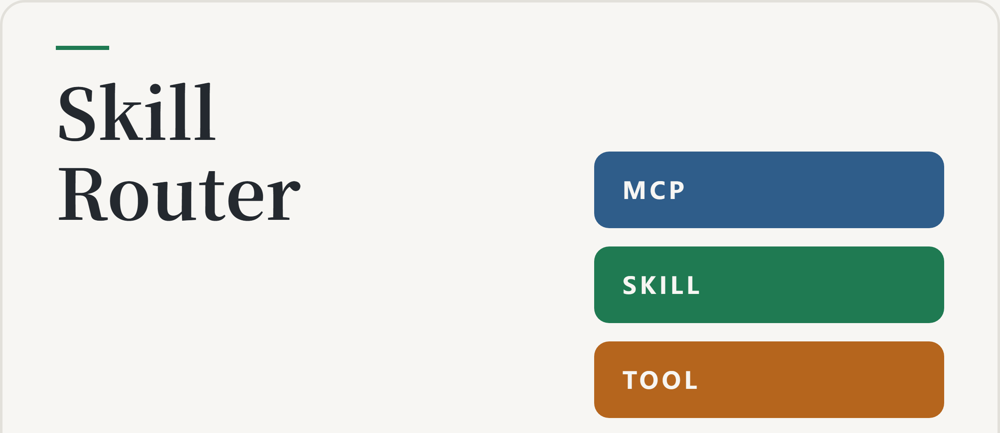
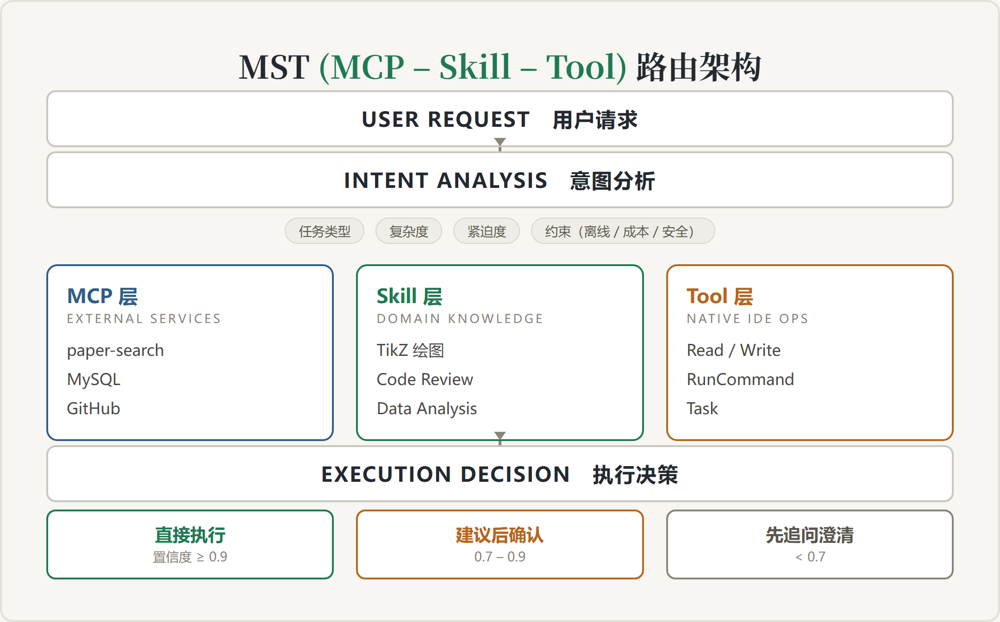

<p align="center">
  
</p>

# Skill Router v3

[](LICENSE)

> 零安装的 MCP-Skill-Tool 路由器：一个纯 Markdown 的 SKILL.md，让 AI 在你的技能、MCP 和工具里自己选路。装进 skills 目录就能用，不跑服务、不建索引、不占运行时。

## 定位：它解决的是另一类问题

2026 年下半年出现了一批检索式技能路由器（见下面的对比表）。它们的思路是：本地起一个服务，把技能库做成向量/关键词索引，用检索打分代替 LLM 挑选。打分更准、可评测，这是对的，也是这个方向的主流。

但它们都要求安装和运行：Ollama、SQLite、FAISS，甚至 Postgres。如果你的情况是——

- 技能数量在 10–50 个，还没有多到需要检索；
- 在多台机器、多个客户端之间切换，不想每处都装服务；
- 只想丢一个文件进 skills 目录就完事；

那检索式方案对你是过度工程。Skill Router v3 就是给这种情况的：**把「该用哪个」的判断写成结构化的 prompt，交给已经在跑的模型本身**。代价是精度依赖模型能力，且没有检索打分那么可复现——这个取舍写在下面，不藏着。

## 和同类项目的对比

数字均为各项目自己报告，未复测。选择标准不是谁数字高，而是你愿意付多少安装成本。

| | [skill-router-mcp](https://github.com/anujkumar8076/skill-router-mcp) | [skillsearch-mcp](https://github.com/thishuixinxin-create/skillsearch-mcp) | skill-retrieval-mcp | Routed | **本项目** |
|---|---|---|---|---|---|
| 路由方式 | Ollama embedding + 关键词兜底 | 中文向量 + BM25 RRF 融合 | FAISS 语义检索 | 向量+BM25+精确+元数据四路混合 | LLM 按 prompt 规则决策 |
| 报告精度 | Top-1 93.8%（48 查询基准） | — | Top-1 81.4%（43 查询） | MRR 78.8%，误触发 0% | **Top-1 86.7%**（自建 30 条，见下方说明） |
| 延迟 | ~69ms（语义） | ~100ms | — | <20ms | 一次模型内推理 |
| 需要安装 | Node + Ollama | Python + Ollama | Python + FAISS | 独立二进制 | **无，复制一个文件** |
| 形态 | MCP server | MCP server | MCP server | MCP server / CLI | 纯 SKILL.md |
| 适用规模 | 数十到数百 | 数十到数百 | 数百 | 数十到数百 | ≤50 个 |

> skill-retrieval-mcp 与 Routed 未附仓库链接，因为检索结果里只有聚合站页面，没拿到可靠的原仓库地址；需要时可自行搜索。

## 它怎么工作

```
你说: "画个 Transformer 架构图放论文里"
  ↓
分析意图 → 科研插图 + LaTeX/TikZ（置信度 0.95）
  ↓
调用 tikz-diagrams-guide + figura
  ↓
生成 .tex → 编译 PDF → 出图
```

不需要记每个 Skill 的名字，也不需要手动选择。三层结构：

| 层 | 干什么的 | 例子 |
|---|---------|------|
| **MCP** | 接外部服务 | 论文搜索、MySQL、GitHub |
| **Skill** | 领域知识 | TikZ 绘图、代码审查、数据分析 |
| **Tool** | IDE 原生操作 | 读写文件、跑命令 |

三层汇聚到同一个决策点，按置信度分三种走法：

- **置信度 ≥ 0.9** — 直接干
- **0.7 ~ 0.9** — 给建议，确认后执行
- **< 0.7** — 先问清楚再动手

诚实说明：这里的置信度是模型对自身判断的自评分，不是检索系统那种有校准依据的分数。它的价值在于给了对话一个明确的分叉规则（直接做 / 确认 / 追问），而不是提供精度保证。

<p align="center">
  
</p>

## 使用计数

路由历史记录在 `skill-router-state.yaml`（见 `templates/`）：每次路由记录用了哪个技能、结果如何。这些计数有两个用途：

1. **给提示词喂事实**——「你上次遇到 X 用的 A 方案失败了」，比让模型凭空回忆可靠；
2. **为评测积累数据**——计数值本身就是未来做检索化（v4）时的标注素材。

它不会自动改写路由规则。基于计数的自动调权在路线图里，前提是先有评测集证明计数和正确率相关。

## 预设了这些组合

| 场景 | 用到的组件 |
|------|-----------|
| 找论文 + 读 + 整理 | `paper-search` + `literature-search` + `Read` |
| 画科研图 + 编译 | `tikz-diagrams-guide` + `figura` + `RunCommand(pdflatex)` |
| Excel 数据出报告 | `MySQL`(可选) + `data-analysis` + `Read` |
| Figma 设计稿转代码 | `figma` + `frontend-design` + `shadcn` + `Write` |
| 代码审查 + 安全扫描 | `TRAE-code-review` + `TRAE-security-review` + `Read` |
| 网页内容转笔记 | `defuddle` + `obsidian-markdown` + `WebFetch` |
| 系统综述 (PRISMA) | `paper-search` + `academic-research-assistant` + `Task` |
| Web 应用测试 | `dogfood` + `agent-browser` + `RunCommand` |
| 搭落地页 | `web-dev` + `frontend-design` + `theme-factory` |
| 论文从零到发表 | 全套 MCP + Skill + Tool 链路 |

## 两个版本

| 版本 | 大小 | 适合谁 |
|------|------|--------|
| **v3** (~15KB) | 完整 MST 三层 | 需要 MCP 管理、复杂任务编排 |
| **lite** (~5KB) | 纯决策树，无 MCP 层 | 只想要「帮我选 skill」 |

## 安装

### Trae

```bash
curl -sSL https://raw.githubusercontent.com/Eastr5/skill-router-v3/main/install.sh | bash
```

### Claude Code

```bash
mkdir -p ~/.claude/skills/skill-router
curl -sSL https://raw.githubusercontent.com/Eastr5/skill-router-v3/main/skills/skill-router/SKILL.md \
  -o ~/.claude/skills/skill-router/SKILL.md
```

### Cursor / VSCode

把 `skills/skill-router/SKILL.md` 复制到对应的 skills 目录即可。

## 评测结果

`evals/golden.yaml`（30 条：直述/转述/间接各 10，标注先于跑分）+ `evals/run_eval.py`（零依赖）。模型 deepseek-v4.1-flash，2026-11-09：

| 指标 | 直述 | 转述 | 间接 | 总计 |
|---|---|---|---|---|
| Top-1 | 9/10 | 10/10 | 7/10 | **26/30（86.7%）** |
| Any-hit | — | — | — | 27/30（90.0%） |

口径说明，不藏着：

- 首轮跑分 Top-1 80.0%。三个 miss 是评分器没归一化 MCP 注册名（`mcp_MySQL_*` vs `MySQL`），修的是脚本不是标注；一条（i06）经复诊放宽了 also_ok 并在 golden.yaml 里注明修订原因；这两处修完后复跑得 86.7%。
- 同一 case 温度 0 也不保证逐字复现，两次跑分有波动。表里报的是修复口径后的那次。
- 与其他项目的数字**不可直接互比**：查询集、技能库、宿主模型都不同。可比性要等标准化基准出现。
- 真 miss 两条值得看：`d10`（系统综述流程选了 literature-search 而非 academic-research-assistant，技能描述相近），`i07`（周期性汇总任务先澄清——可辩护但没命中标注）。

## 路线图

- [ ] **评测集**：`evals/golden.yaml` 已就位——30 条查询（直述/转述/间接各 10），标注写在测试之前；跑分脚本 `evals/run_eval.py`（零依赖，OpenAI 兼容接口，支持 --dry-run）。尚未跑分，结果出来后更新本表
- [ ] **检索化（v4）**：本地 embedding + BM25 混合打分的 `match_skill`，评测集作为验收标准
- [ ] **Decision model 后端（v4）**：参考 Jev / System One 范式（typed Choice/Score + 校准概率，如开源的 Laya 421M），作为可选打分后端——替换「模型自报置信度」这块目前最弱的环节；默认仍为零安装的 prompt 模式，评测集作为两种后端的对比验收标准
- [ ] 基于使用计数的自动调权（依赖评测集先行）

## 致谢与来源

三层的分层思路参考了 MCP（模型上下文协议）的 tool 生态与 Agent Skills（SKILL.md）规范；`skills/` 下的 `figura`、`tikz-diagrams-guide` 来自各自上游仓库，版权归原作者所有。
